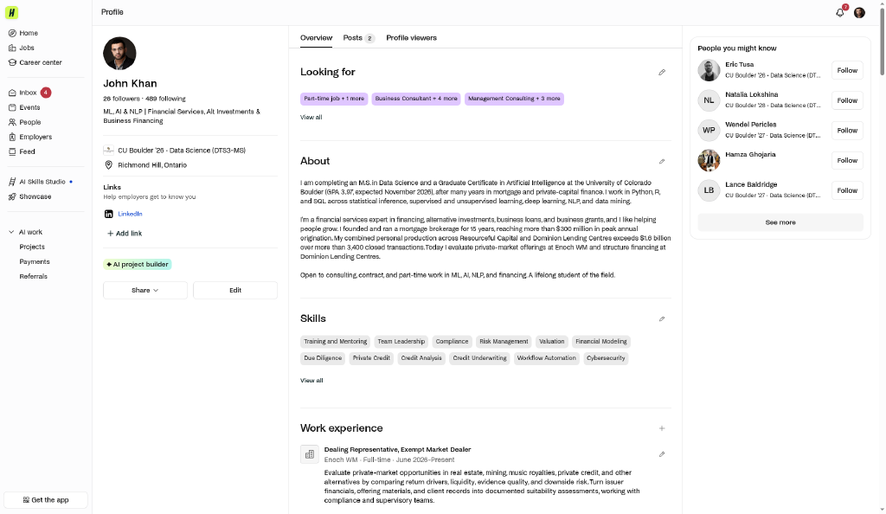

# Handshake

## Badge

| Badge | Issuer | File |
|---|---|---|
| AI project builder | Handshake | [Badge](ai-project-builder-badge.png), [Profile](ai-project-builder-profile.png) |

## AI Skills Studio missions

Handshake does not issue certificate files for these. The project pages sit inside Handshake, so you need to be signed in to view them.

| Mission or challenge | Issuer | Date earned | File | Verify |
|---|---|---|---|---|
| Set Up a Sales CRM | Handshake with Notion | not recorded | none | [Deal Desk CRM](https://app.joinhandshake.com/ai-showcase/projects/3561659) |
| Set Up a Job Search Command Center | Handshake with Notion | not recorded | none | [Gig and Consulting Command Center](https://app.joinhandshake.com/ai-showcase/projects/3561640) |
| Turn Data into an Interactive Dashboard | Handshake with OpenAI | not recorded | none | [Canada's Rate Cycle](https://app.joinhandshake.com/ai-showcase/projects/3596210) |
| Pitch Your Idea in Ten Slides | Handshake with Gamma | not recorded | none | [RenewalCheck Pitch Deck](https://app.joinhandshake.com/ai-showcase/projects/3596216) |
| Present Your Insights in a Persuasive Deck | Handshake with Gamma | not recorded | none | [Stress Is Moving to the Edge](https://app.joinhandshake.com/ai-showcase/projects/3562531) |
| How Evals Improve AI Models | Handshake with OpenAI | not recorded | none | [Eval: 2019 vs 2023](https://app.joinhandshake.com/ai-showcase/projects/3562557) |
| Create a Multiplayer Game challenge | Handshake with OpenAI | not recorded | none | [Rise of Realms](https://app.joinhandshake.com/ai-showcase/projects/3515815) |
